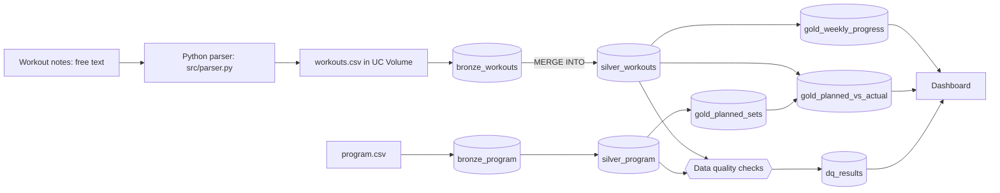
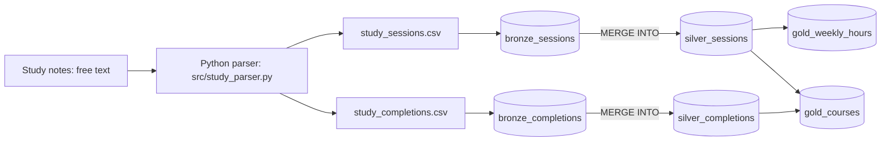
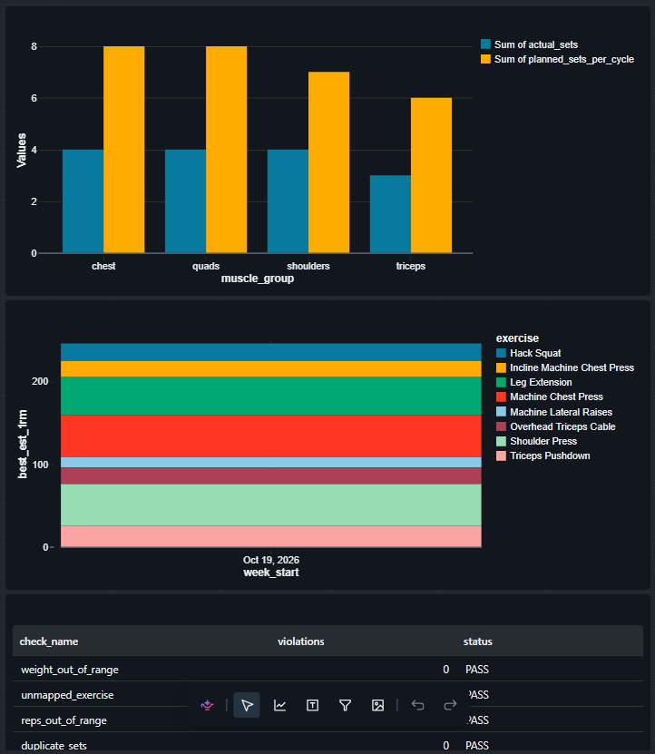

# Personal Data Lakehouse

An end-to-end data engineering project built on my own personal data, running on Databricks (Delta Lake, Spark SQL, PySpark) with Python for parsing and testing.

I log things as free-text notes. Python parsers turn them into structured rows, a Bronze → Silver → Gold pipeline models them, SQL data-quality checks guard the output, and a Databricks Job orchestrates every domain as an independent task.

## Domains

| Domain | Schema | What it tracks |
|---|---|---|
| Gym | `workspace.gym` | Workout sets, weekly volume, estimated 1RM, planned vs actual sets per muscle group |
| Study | `workspace.study` | Study sessions per topic, weekly hours, course start and completion dates |

Each domain has its own parser, notebook and schema. The Bronze → Silver → Gold pattern is shared, so adding a new domain means adding a parser and a notebook.

## Architecture: gym



## Architecture: study



Study notes look like this. A `done` line closes a course, and a course without one shows as in progress:

```
2026-10-19
Associate SQL in Data Engineer 90 min joins
2026-10-28
done Associate SQL in Data Engineer
```

## Layers

| Layer | Gym tables | Study tables |
|---|---|---|
| Bronze | `bronze_workouts`, `bronze_program` | `bronze_sessions`, `bronze_completions` |
| Silver | `silver_workouts`, `silver_program` | `silver_sessions`, `silver_completions` |
| Gold | `gold_weekly_progress`, `gold_planned_sets`, `gold_planned_vs_actual`, `gold_weight_progress` | `gold_weekly_hours`, `gold_courses` |

Silver tables load incrementally with `MERGE INTO`, so re-running the pipeline never duplicates rows and corrected entries are updated in place.

## Data quality

For the gym domain, SQL checks write to `dq_results` (unmapped exercises, weight and reps out of range, future dates, duplicate sets). A final notebook cell raises an error if any check fails, so the Databricks Job stops instead of publishing bad data.

## Orchestration and CI

- A Databricks Job runs one task per domain (`run_pipeline` for gym, `run_study` for study). The tasks are independent, so a failure in one does not stop the other.
- GitHub Actions runs the parser unit tests (`pytest`) on every push.

## Dashboard (gym)



## Repository layout

```
notebooks/gym_medallion.py        Gym notebook (pipeline, SQL, checks)
notebooks/study_lakehouse.ipynb   Study notebook
src/parser.py                     Gym notes parser
src/study_parser.py               Study notes parser
tests/                            Parser unit tests
.github/workflows/tests.yml       CI
docs/dashboard.png                Dashboard screenshot
```

## Run locally (tests)

```
pip install pytest
python -m pytest -q
```

## Run on Databricks

1. Add this repo as a Git folder in the workspace.
2. Open a notebook from `notebooks/` and run the cells in order, or run both as tasks of one Job.

## Possible next steps

- Keep notes as files in the Volumes so scheduled runs pick up new entries without editing a notebook.
- Make Bronze append-only (Auto Loader).
- Log skipped parser lines to a table and add them to the checks.
- Add data-quality checks and a dashboard for the study domain.
