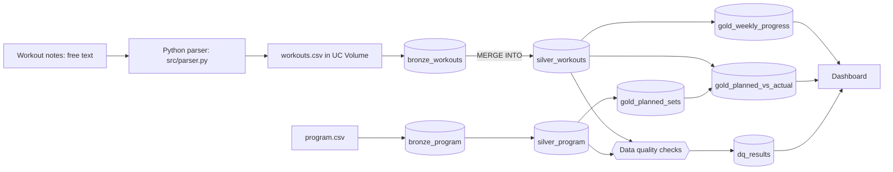

# Personal Data Lakehouse

An end-to-end data engineering project built on my own gym training data, running on Databricks (Delta Lake, Spark SQL, PySpark) with Python for parsing and testing.

I log workouts as free-text notes. A parser turns them into structured rows, a Bronze → Silver → Gold pipeline models them, SQL data-quality checks guard the output, and a Databricks Job orchestrates everything.

## Architecture



## Layers

| Layer | Tables | Notes |
|---|---|---|
| Bronze | `bronze_workouts`, `bronze_program` | Raw rows plus ingestion metadata |
| Silver | `silver_workouts`, `silver_program` | Typed and cleaned. Workouts load incrementally with `MERGE INTO` on (date, exercise, set) |
| Gold | `gold_weekly_progress`, `gold_planned_sets`, `gold_planned_vs_actual` | Weekly volume and estimated 1RM, planned sets per muscle group, plan vs actual |

## Data quality

SQL checks write to `dq_results` (unmapped exercises, weight and reps out of range, future dates, duplicate sets). A final notebook cell raises an error if any check fails, so the Databricks Job stops instead of publishing bad data.

## Orchestration and CI

- A Databricks Job runs the notebook end to end.
- GitHub Actions runs the parser unit tests (`pytest`) on every push.

## Dashboard


## Repository layout

```
notebooks/gym_medallion.py   Databricks notebook (pipeline, SQL, checks)
src/parser.py                Free-text notes parser
tests/test_parser.py         Parser unit tests
.github/workflows/tests.yml  CI
docs/dashboard.png           Dashboard screenshot
```

## Run locally (tests)

```
pip install pytest
python -m pytest -q
```

## Run on Databricks

1. Add this repo as a Git folder in the workspace.
2. Open `notebooks/gym_medallion` and run the cells in order, or run it as a Job.

## Possible next steps

- Keep notes as a file in the Volume so scheduled runs pick up new sessions without editing the notebook.
- Make Bronze append-only (Auto Loader).
- Log skipped parser lines to a table and add them to the checks.
